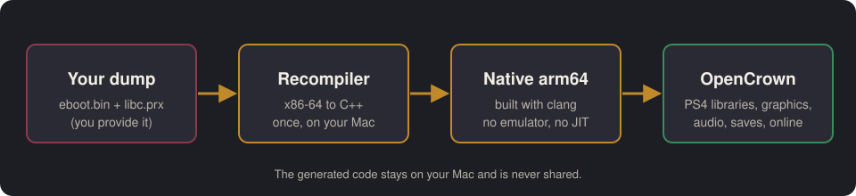
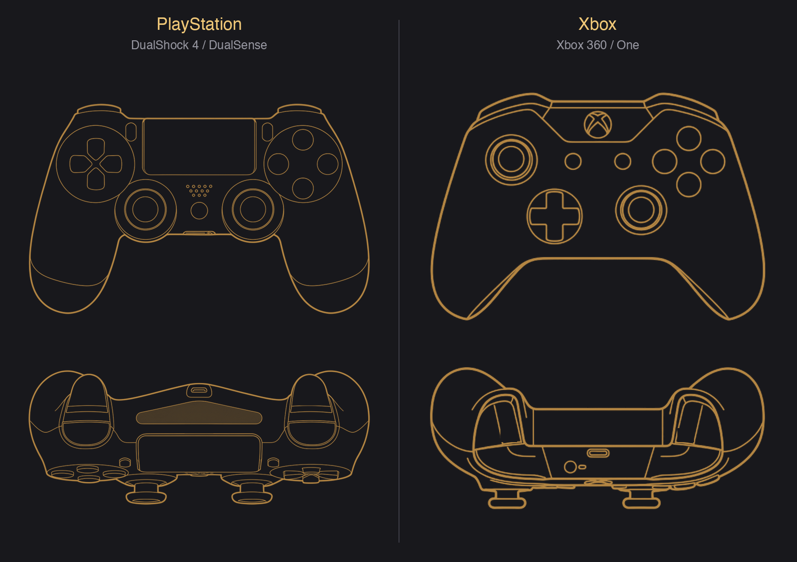

<h1 align="center">OpenCrown for Mac</h1>

<p align="center"><i>Dragon's Crown Pro, running natively on Apple Silicon</i></p>

<p align="center">
  <a href="https://github.com/Alountk/OpenCrown-MAC/releases/latest"></a>
  
  
  
  <a href="https://discord.gg/srBT23NYRA"></a>
</p>

<p align="center">
  <b><a href="#getting-started">Getting started</a></b> ·
  <a href="#how-it-works">How it works</a> ·
  <a href="#controllers">Controllers</a> ·
  <a href="#online">Online</a> ·
  <a href="#building-from-source">Building</a> ·
  <a href="#credit-and-licence">Credit</a> ·
  <a href="../docs/MAC.md">Full guide</a>
</p>

<p align="center">
  
</p>

This is a **macOS contribution to [OpenCrown PC](https://github.com/Nezara/OpenCrown-PC)**, the project by **Nezara** that lets you play Dragon's Crown Pro on a computer from a dump of your own copy. It is made with the author's permission. The loader, the PS4 system libraries, the renderer, saves, online play and the launcher are Nezara's work; this fork adds what a Mac needs to run them.

> [!IMPORTANT]
> **No game files are included, and none will ever be.** You need your own decrypted dump of Dragon's Crown Pro (CUSA10454): the folder with `eboot.bin` and `sce_module/libc.prx`.

## What you get

- 🍎 **Native on Apple Silicon.** No emulator, no JIT: your dump is recompiled to C++ and built for arm64. Checked at 60 fps on an M2 Pro.
- 🎮 **PlayStation and Xbox controllers** work out of the box, with a visual controller view and a setup wizard in the launcher.
- 🌐 **Online co-op** through OpenCrown's public lobby, so Mac players join the same rooms as everyone else. Friend codes included.
- 🔊 **Audio, saves and the full game**, played from the title through the levels.
- 📦 **A normal Mac app**: `OpenCrown.app` in a `.dmg`, with an icon and a launcher.
- 🧪 **Checked against the original**: the recompiler is tested instruction by instruction against Rosetta 2 (1,287 cases, 0 failures).

## Getting started

1. Download the latest `.dmg` from **[Releases](https://github.com/Alountk/OpenCrown-MAC/releases)**, open it and drag **OpenCrown** to Applications.
2. The app is signed ad hoc and not notarized (that needs a paid Apple Developer account), so the first time **right click it and choose Open**.
3. Point it at your dump and press **Play**. The first run recompiles and builds the game on your Mac (a few minutes; it needs `cmake` and the Xcode command line tools). After that it starts in seconds.

## How it works

A Mac cannot run the game's x86-64 code directly, so this fork **statically recompiles your own dump to C++** and builds it natively. The generated code stays on your Mac, outside this repository, and is never shared. Everything else (graphics over Metal, audio, input, saves, online) is OpenCrown's, with Mac fixes. More in [docs/MAC.md](../docs/MAC.md).

## Controllers

<p align="center">
  
</p>

In the game, hold **touchpad click + Options** (PlayStation) or **View + Menu** (Xbox) for 2 seconds to quit.

## Online

Online play is OpenCrown's own. To try it on a single Mac with two copies of the game, see [docs/MAC.md](../docs/MAC.md#online).

## Building from source

```sh
cd linux-port
./play-mac.sh /path/to/your/dump/CUSA10454
```

Needs a Mac with Apple Silicon, `cmake` and the Xcode command line tools. Details, the launcher and the `.app` build are in [docs/MAC.md](../docs/MAC.md). Releases are listed in the [changelog](../docs/CHANGELOG.md) and the plan is in the [roadmap](../docs/ROADMAP.md).

## Credit and licence

- **OpenCrown** is Nezara's project and its code is not relicensed here: this fork uses it with their permission. Please go to the [original repository](https://github.com/Nezara/OpenCrown-PC) and its [Discord](https://discord.gg/srBT23NYRA) for everything about OpenCrown itself, and consider supporting the author.
- The fork's own additions (the recompiler and the Mac scripts) are **MIT**. Details in [docs/NOTICE.md](../docs/NOTICE.md).
- Dragon's Crown belongs to Vanillaware and Atlus. This is a hobby project, not affiliated with or endorsed by Vanillaware, Atlus, Sony or Nezara.

Upstream's own README, with everything about OpenCrown, is [here](../README.md).
