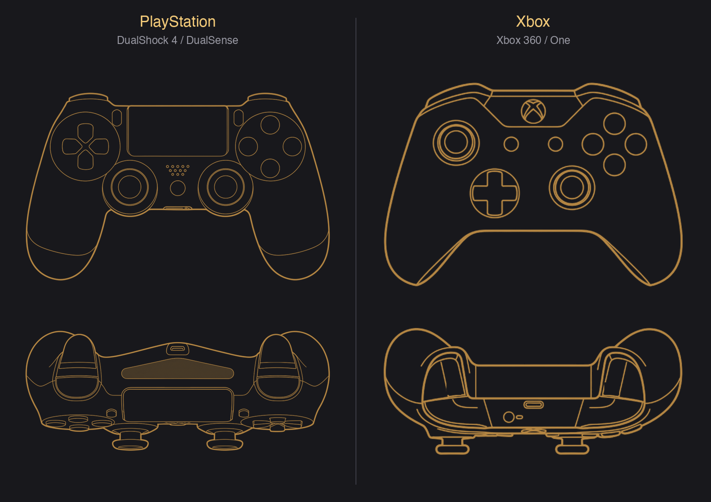

# OpenCrown on macOS (Apple Silicon)

This repository is a fork of [Nezara/OpenCrown-PC](https://github.com/Nezara/OpenCrown-PC) that runs **Dragon's Crown Pro natively on Apple Silicon**. All credit for the project itself (the loader, the PS4 system libraries, the renderer, saves, online play) goes to the upstream author. This page covers only what the fork adds. The main [README](../README.md) is upstream's and is left as it is, so that upstream changes merge cleanly.

> [!IMPORTANT]
> **No game files are included, and none will ever be.** You need your own decrypted dump of Dragon's Crown Pro (CUSA10454): the folder with `eboot.bin` and `sce_module/libc.prx`.

## How it differs from upstream

Upstream runs the game's x86-64 code directly on the CPU. An Apple Silicon Mac cannot do that, so this fork **statically recompiles your own dump to C++** and builds it natively for arm64 (no JIT, no emulator). The recompiler (`linux-port/recomp/`) reads your `eboot.bin` and PRX modules and writes C++ into a folder outside this repository. Nothing derived from your game files is ever committed. The rest of the stack (HLE, renderer, audio, input, online) is upstream's, with Mac-specific fixes.

Progress and open items are tracked in [ROADMAP.md](ROADMAP.md).

## Requirements

- A Mac with Apple Silicon and macOS with the Xcode command line tools (`xcode-select --install`)
- `cmake` (and `ninja`, used when installed)
- Your own dump, as described above

## Play

```sh
cd linux-port
./play-mac.sh /path/to/your/dump/CUSA10454          # the folder holding eboot.bin
./play-mac.sh /path/to/eboot.bin --fullscreen       # extra options go to dcp_run
```

The first run recompiles your dump and builds the game (a few minutes); later runs take seconds, until the dump or the recompiler changes. Generated code lives in `~/Library/Application Support/OpenCrown/build` (override with `DCP_WORK_DIR`; the script refuses a folder inside a git repository). Saves, settings and logs are in `~/Library/Application Support/OpenCrown/`.

## The launcher on macOS

```sh
cd linux-port
cmake -S . -B build -DDCP_RECOMPILED=ON
cmake --build build --target opencrown_launcher
./build/opencrown-launcher
```

The launcher is upstream's, adapted for macOS:

- **Play** runs `play-mac.sh` and shows its step (preparing, recompiling, building); **Stop** ends it.
- There is no AppImage updater on macOS.
- In the game, hold **Select + Start** (Back + Menu on an Xbox pad) to quit.

## Controllers

PlayStation and Xbox controllers work out of the box: the game reads them through SDL's gamepad API, which already maps them. The launcher's Controls page draws the controller you have connected (PlayStation's for any other or none) with a label on every button showing the key bound to it. Hover a label to colour its button; click it to rebind.



For any other controller, or if buttons do the wrong thing, use **Set up a gamepad...** on the Controls page. It asks for each button in turn, shows the drawing with the button it wants, and saves the mapping in your user folder (`gamepad_mappings.txt`), which the game loads at start.

On an Xbox pad the View button takes the place of the PlayStation touchpad click.

## Online

Online play is upstream's. On one Mac you can test it with two copies of the game:

```sh
cd linux-port
./play-mac-online-test.sh /path/to/your/dump/CUSA10454
```

It starts a local lobby and two game copies (keyboard and mouse in one, gamepad in the other). Separate cameras (`own_camera`) apply from the start of a real adventure, not in the first screens (stables, lobby).

## Keeping up with upstream

The remotes are `origin` (this fork) and `upstream` (Nezara/OpenCrown-PC). **Never push or open a pull request to `upstream`.**

Most of the fork's work is in new files (`linux-port/recomp/`, `play-mac*.sh`, the launcher's controller view and tests), which upstream cannot conflict with. Where the fork edits files upstream also has, conflicts are possible:

| Area | Files |
| --- | --- |
| Build | `linux-port/CMakeLists.txt`, `linux-port/build.sh`, `.gitignore` |
| HLE | `linux-port/src/hle/` (`gnm.cpp`, `np.cpp`, `matching2.cpp`, `own_camera.cpp`, `skip_offers.cpp`, `confirm_button.cpp`, `kernel/`) |
| Loader | `linux-port/src/loader/` |
| Network | `linux-port/src/net/` |
| Renderer | `linux-port/src/render/` |
| Game runner and launcher | `linux-port/tools/dcp_run/`, `linux-port/tools/launcher/` |

To bring in upstream changes without breaking what works:

1. Start from a clean `main` and tag it: `git tag mac-before-sync-<date>`.
2. `git fetch upstream`, then look at `git log --oneline main..upstream/main`.
3. Branch (`sync/upstream-<date>`) and `git merge upstream/main`. Merge, do not rebase, so the history stays readable.
4. Resolve conflicts keeping the macOS behaviour (it is guarded with `__APPLE__`, so Linux and Windows stay as upstream has them).
5. Build, run the tests (`ctest`), and play from the title screen to a level with `play-mac.sh` before opening the pull request into `main`. On Apple Silicon, `cpu_compat` is not run (it needs x86-64) and `test_net` has a timing check that can flake; both are known and unrelated.

If the result is wrong, `git reset --hard mac-before-sync-<date>` on the sync branch (or just delete the branch) puts everything back.

## Legal

This is a hobby project, not affiliated with or endorsed by Vanillaware, Atlus, Sony or the upstream author. Asking the upstream author for permission or a licence for the fork is still an open item in the [roadmap](ROADMAP.md).
